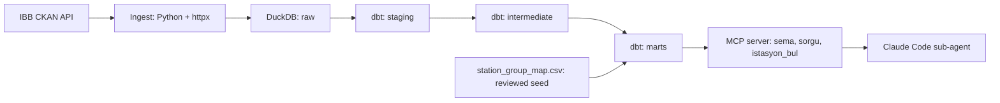

# istanbul-rail-ridership

Istanbul rail ridership from IBB Open Data, transformed with DuckDB and dbt and queried through a read-only MCP server and Claude Code sub-agent.

**Status: v0.1 — historical daily data for 2021–2025; not real-time.**

## What you can ask

The [Claude Code agent example](examples/claude-code/ulasim.md) supports questions about the busiest station complexes, monthly line trends, and weekday/weekend differences. It resolves station names before querying and answers in Turkish with the SQL and data coverage. Questions about yesterday or hourly traffic are outside its coverage.

Acceptance questions for v0.1, answered by the agent and re-checked with independent SQL ([full results](docs/M3.md#results-2026-11-15)):

| Question (asked in Turkish) | Answer |
|---|---|
| Busiest stations in 2025? | Yenikapı 71.5 M journeys, Üsküdar 43.6 M, Şişli-Mecidiyeköy 39.7 M (station complexes, all lines combined) |
| M4 line: weekday vs weekend average in 2025? | 325,353 vs 215,878 journeys per day |
| Yenikapı's monthly trend? | Summer low (about 170k per day in July–August), autumn high (about 217k per day in October–December) |
| Total 2025 journeys of stations in Küçükçekmece? | 20.3 M across 8 stations (depends on the source district field, see limitations) |
| How many people rode yesterday? | Refused: the data ends on 2025-12-31 |

## Architecture



DuckDB keeps the raw data and analytical models in a local database file. dbt separates source preservation, cleaning, quality flags and aggregation, with unit tests and reconciliation checks. Model descriptions are persisted as database comments so the MCP `sema` tool can expose the schema and caveats to the agent. MCP gives the agent a small interface for discovering tables, resolving station names and running bounded read-only queries. Ingest uses the CKAN datastore API rather than the CSV download because it returns UTF-8 JSON with a total row count; the script checks fetched and loaded counts against that total and replaces each resource's rows transactionally on reruns.

## Data model

The `marts` models are tables. Grain and column descriptions are defined in [_marts.yml](transform/models/marts/_marts.yml) and [_station_groups.yml](transform/models/marts/_station_groups.yml).

| Model | Grain: one row per… | Key columns and useful attributes |
|---|---|---|
| `dim_station` | entrance/platform station code | `station_code`; latest non-NULL `station_name`, `district`, coordinates, `station_group`, first/last dates |
| `dim_line` | repaired line name | `line_name`; `line_code`, `has_line_level_rows`, first/last dates |
| `dim_station_group` | non-NULL physical station complex | `station_group`; member `station_codes`, `line_names`, `districts`, first/last dates |
| `fct_station_daily` | date × station code × line | `ride_date`, `station_code`, `line_name`; journey/passenger counts, `entrance_rows`, estimate and suspect flag |
| `fct_line_daily` | date × line, including rows without a station | `ride_date`, `line_name`; journey/passenger counts, `station_count`, line-level flag, estimate and suspect flag |
| `fct_station_group_daily` | date × physical station complex | `ride_date`, `station_group`; journey/passenger sums, estimate, suspect flag, `line_count` |

The intermediate views are described in [_intermediate.yml](transform/models/intermediate/_intermediate.yml):

- `int_rail_entrance_deduped`: one row per distinct entrance observation, keeping the smallest source row ID among duplicates.
- `int_journey_quality_daily`: one row per date, with the even-count share, journey/passenger ratio and `journey_suspect` flag.
- `int_rail_entrance_daily`: one row per deduplicated entrance observation, with the daily flag and `journey_count_estimated` appended.

`journey_count` measures journeys (turnstile passages). Summed `passenger_count` may count a person more than once across entrances; use journeys for comparisons across years, with the estimate caveat below.

## Data quality decisions

- **Keep entrance detail in staging; aggregate later.** The 2025 profile found 5,322 date/code/line combinations with 2–3 distinct entrance rows ([M1](docs/M1.md)).
- **Repair coordinates without inventing missing values.** Misplaced decimal dots are repaired; nonnumeric or missing coordinates become NULL, and a missing member makes both coordinates NULL. The 2025 profile had 23,858 rows (17.6%) without coordinates and 365 Yenisahra rows with invalid `29.Eyl` longitude ([M1](docs/M1.md)).
- **Flag line totals.** A NULL station code sets `is_line_level`; these rows feed `fct_line_daily`, not station facts. M1 recorded 728 such rows in 2025, across two lines ([M1](docs/M1.md)).
- **Remove exact duplicates in intermediate.** Staging retains all source rows; the documented deduplication result removed 9,706 rows ([M2](docs/M2.md)).
- **Normalize empty codes and names to NULL and repair Turkish mojibake.** M2 recorded 760 rows with a code but no station name; these remain distinguishable from line totals ([M2](docs/M2.md)).
- **Flag the apparent 2022 doubling; preserve source counts.** `journey_suspect` identifies 218 days between 2022-03-28 and 2022-11-02. The rule requires an even-count share of at least 0.99 and a journey/passenger ratio of at least 1.8. Two days inside that interval, 2022-10-31 and 2022-11-01, are not flagged. `journey_count_estimated` uses integer division by 2 on flagged days and the original count otherwise. Raw data is untouched; the estimate is the project's assumption, not an official IBB correction ([M2](docs/M2.md#2022-journey-count-anomaly-m21)).
- **Group codes into physical complexes through a reviewed mapping seed.** The current mapping covers 371 codes → 253 groups, confirmed against the local database read-only. The seed supports human review; groups are a project mapping, not an IBB field ([seed](transform/seeds/station_group_map.csv), [M3](docs/M3.md)).
- **Treat the source district field as unreliable.** District-based analysis needs additional validation.

Final build at M3: `dbt build` PASS=64, WARN=6, ERROR=0. The six warnings are the data-quality tests above, kept as warnings on purpose so the counts stay visible. Python: 106 tests pass ([M3 results](docs/M3.md#results-2026-11-15)).

## Quickstart

Prerequisites: **uv and Python 3.13**. Run all commands from the repository root. Data is downloaded locally from the [IBB dataset](https://data.ibb.gov.tr/dataset/rayli-sistemler-istasyon-bazli-yolcu-ve-yolculuk-sayilari); it is not included in this repository.

```sh
uv sync
```

Load all five yearly resources (about 1.9 million rows from the IBB API; this takes a few minutes and must finish before `dbt build`). On Windows, set `PYTHONUTF8=1` before Python or dbt commands so Turkish characters are handled correctly.

PowerShell:

```powershell
$env:PYTHONUTF8 = "1"
$resources = @(
    "604776d6-e99f-469c-bf25-25ccadc5e89b" # 2021
    "5c2b78fc-3b68-4722-844f-3051c358a13f" # 2022
    "5de4fee9-4b31-45f3-bb8d-f566e6a302af" # 2023
    "6028373f-6bcf-45a9-95a3-f3f741b4b55e" # 2024
    "cce8e138-686a-4b8d-bac0-c2a0ab294a6e" # 2025
)
foreach ($resource in $resources) {
    uv run python ingest/rail_station_daily.py --resource-id $resource
    if ($LASTEXITCODE -ne 0) { throw "Ingest failed for $resource" }
}
```

Bash:

```bash
export PYTHONUTF8=1
for resource in \
    604776d6-e99f-469c-bf25-25ccadc5e89b \
    5c2b78fc-3b68-4722-844f-3051c358a13f \
    5de4fee9-4b31-45f3-bb8d-f566e6a302af \
    6028373f-6bcf-45a9-95a3-f3f741b4b55e \
    cce8e138-686a-4b8d-bac0-c2a0ab294a6e
do
    uv run python ingest/rail_station_daily.py --resource-id "$resource" || exit 1
done
```

Then build the models and seed, run the Python tests, and start the stdio MCP server:

```sh
uv run dbt build --project-dir transform --profiles-dir transform
uv run pytest -q
uv run python ulasim_mcp/server.py
```

The default database is `data/ulasim.duckdb`. The dbt profile accepts `ULASIM_DUCKDB_PATH` to override it; the ingest script accepts `--db`. If you change the location, also set the MCP server's `ULASIM_DB` to the same database file. Stop analysis queries while rebuilding: a writer can prevent the server from opening a read-only connection.

## Use it from Claude Code

Copy [examples/claude-code/mcp.json](examples/claude-code/mcp.json) into your project's `.mcp.json` (merge `mcpServers` if a configuration already exists). Copy [examples/claude-code/ulasim.md](examples/claude-code/ulasim.md) into `.claude/agents/`. Replace every `<path-to-repo>` placeholder with your repository path. The example registers `ulasim` with stdio transport and the Windows virtual-environment interpreter; on macOS/Linux use `<path-to-repo>/.venv/bin/python` instead. Keep the server name `ulasim`: the agent's tools are named `mcp__ulasim__*`. The agent answers in Turkish.

The [server](ulasim_mcp/server.py) finds its database through `ULASIM_DB`, or defaults to `data/ulasim.duckdb` relative to the repository containing the server file, independently of the working directory. Each tool call opens and closes its own read-only connection, with external access disabled and configuration locked. `sorgu` accepts exactly one statement classified by DuckDB as SELECT, including SELECT queries with CTEs. Its default result limit is 200 rows, clamped to 1–1000; it fetches one extra row to report truncation. Queries are interrupted after 30 seconds by default; `ULASIM_SORGU_ZAMAN_ASIMI` can set a positive finite timeout in seconds. These controls do not restrict SELECT queries to the `marts` schema; `sema` lists only marts metadata.

## Limitations

- Daily observations only; no hourly traffic.
- Historical coverage ends on 2025-12-31; no live service or ridership data.
- This is an analytical tool, not a trip planner.
- The source district field is unreliable.
- The 2022 estimate is a project assumption, not IBB's correction; the flag does not establish the anomaly's cause.
- Station groups are a reviewed project mapping, not an official source field.
- A local single-user stdio tool with no authentication, not a public API.

## How this was built

Code, tests and documentation were written by AI agents; Yalçın Çiftçi did not write code. Yalçın directed the project: set the requirements, made the design decisions and reviewed and approved every milestone ([M0](docs/M0.md), [M1](docs/M1.md), [M2](docs/M2.md), [M3](docs/M3.md)).

- **Yalçın Çiftçi (owner):** chose the stack (DuckDB + dbt, uv + Python 3.13, MCP tool + Claude Code sub-agent instead of a paid API), decided to flag the 2022 anomaly and add an estimate column instead of altering source data, chose the reviewed mapping table for station groups and Sonnet 5.5 for the agent.
- **Claude Code (Claude Opus 5.5), orchestrator:** profiled the data, wrote the milestone specs in `docs/` and the task briefs, reviewed the 111 flagged station-group codes, checked every result independently.
- **OpenAI Codex (GPT-6.1 Sol), implementer:** wrote the code, tests and dbt models from the briefs, test-first.
- **Independent audit:** at the end of M1 a model from a different provider (Gemini, via Antigravity) audited the work in a fresh context; its one warning was fixed test-first.

[AGENTS.md](AGENTS.md) records repository rules, responsibilities, boundaries and verification requirements. [.agents/skills/](.agents/skills/) contains reusable engineering workflows and their upstream license notices and source commit identifiers. [.codex/agents/reviewer.toml](.codex/agents/reviewer.toml) configures a separate read-only reviewer role. These files stay in the repository to make the AI-assisted working process inspectable and reusable.

In the milestone docs, *Morks* is the name of the Claude Code orchestrator session, and *project note* / *vault* refer to the owner's private planning notes, which are not part of this repository.

## License

Code is licensed under the [MIT License](LICENSE), copyright 2026 Yalçın Çiftçi.

Data comes from IBB Open Data under the [İBB Açık Veri Lisansı 1.0](https://data.ibb.gov.tr/license) (IBB Open Data License 1.0). Required attribution:

> Atıf 4.0 Uluslararası (CC BY 4.0) kapsamında lisanslanan kamu sektörü bilgilerini içerir.
>
> English: Contains public sector information licensed under Attribution 4.0 International (CC BY 4.0).

This project is not affiliated with or endorsed by Istanbul Metropolitan Municipality (IBB).

Data is downloaded by the user and is not redistributed here; `data/` is git-ignored.

Third-party tooling notices:

- [obra/superpowers](https://github.com/obra/superpowers) engineering skills: MIT; [bundled license](.agents/skills/LICENSE-superpowers.txt).
- [dbt-labs/dbt-agent-skills](https://github.com/dbt-labs/dbt-agent-skills): Apache-2.0; [bundled license](.agents/skills/LICENSE-dbt-agent-skills.txt).
- Reviewer role template from [affaan-m/ECC](https://github.com/affaan-m/ECC): MIT, adapted as credited in [reviewer.toml](.codex/agents/reviewer.toml).

## Türkçe özet

Bu proje, İBB açık verisindeki 2021–2025 günlük raylı sistem yolculuk verilerini DuckDB ve dbt ile analiz edilebilir tablolara dönüştürür. Salt okunur MCP sunucusu ve Claude Code alt ajanı, istasyon ve hat sorularını Türkçe yanıtlar ve kullanılan SQL'i gösterir. İstasyon kodları, gözden geçirilmiş bir eşleme tablosuyla fiziksel istasyon gruplarına bağlanır. Kaynaktaki 2022 anomalisi işaretlenir; özgün sayılar korunurken ayrıca projenin tahmin sütunu sunulur. Veri gerçek zamanlı değildir ve depoda dağıtılmaz; kod MIT, kaynak veri ise İBB Açık Veri Lisansı 1.0 kapsamındadır.
