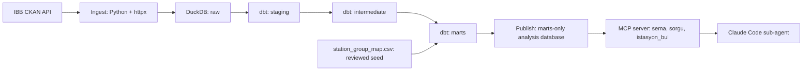

# istanbul-rail-ridership

Istanbul rail ridership from IBB Open Data, transformed with DuckDB and dbt and queried through a read-only MCP server and Claude Code sub-agent.

**Status: v0.1 — historical daily data for 2021–2025; not real-time.**

## What you can ask

The [Claude Code agent example](examples/claude-code/ulasim.md) supports questions about the busiest station complexes, monthly line trends, and weekday/weekend differences. It resolves specific station names mentioned in a question before querying; general rankings query station groups directly. It answers in Turkish with the SQL and data coverage. Typical hourly intensity profiles based on 2023-01–2024-07 are supported; counts for a specific date and hour, and questions about yesterday, are outside its coverage.

Acceptance questions for v0.1, answered by the agent and re-checked with independent SQL ([full results](docs/M3.md#results-2026-11-15)):

| Question (asked in Turkish) | Answer |
|---|---|
| Busiest stations in 2025? | Yenikapı 71.5 M journeys, Üsküdar 43.6 M, Şişli-Mecidiyeköy 39.7 M (station complexes, all lines combined) |
| M4 line: weekday vs weekend average in 2025? | 325,353 vs 215,878 journeys per day |
| Yenikapı's monthly trend? | Summer low (about 170k per day in July–August), autumn high (about 217k per day in October–December) |
| Total 2025 journeys of stations in Küçükçekmece? | 20.3 M across 8 stations (depends on the source district field, see limitations) |
| How many people rode yesterday? | Refused: the data ends on 2025-12-31 |

## Architecture



DuckDB keeps the raw data and analytical models in a local database file. dbt separates source preservation, cleaning, quality flags and aggregation, with unit tests and reconciliation checks. A publisher materializes only marts tables and views into a separate analysis database for MCP. The publisher preserves table and column descriptions from the source catalog in the analysis copy. The MCP `sema` tool exposes columns, coverage and built-in caveats. MCP gives the agent a small interface for discovering tables, resolving station names and running bounded read-only queries. Ingest uses the CKAN datastore API rather than the CSV download because it returns UTF-8 JSON with a total row count; the script checks fetched and loaded counts against that total and replaces each resource's rows transactionally on reruns.

## Data model

The `marts` models are tables. Grain and column descriptions are defined in [_marts.yml](transform/models/marts/_marts.yml) and [_station_groups.yml](transform/models/marts/_station_groups.yml).

The machine-readable [metric contract](metrics/metrics.toml) defines the measures and interpretation rules. MCP `sema` reads its warnings and measure summary from this file; tests require exact agreement with the metric column descriptions in both marts YAML files. After editing the contract, run `uv run python tools/render_agent_rules.py` to regenerate the marked rules in the agent example; `uv run python tools/render_agent_rules.py --check` checks for drift without writing.

| Model | Grain: one row per… | Key columns and useful attributes |
|---|---|---|
| `dim_station` | entrance/platform station code | `station_code`; latest non-NULL `station_name`, `district`, coordinates, `station_group`, first/last dates |
| `dim_calendar_day` | every date in 2021–2025 (1,826 rows) | `ride_date`; ISO weekday, holiday/restriction flags, `is_regular_workday`, Turkish labels and source URLs |
| `dim_line` | repaired line name | `line_name`; `line_code`, `has_line_level_rows`, first/last dates |
| `dim_station_group` | non-NULL physical station complex | `station_group`; member `station_codes`, `line_names`, `districts`, first/last dates |
| `fct_station_daily` | date × station code × line | `ride_date`, `station_code`, `line_name`; journey/passenger counts, `entrance_rows`, estimate and suspect flag |
| `fct_line_daily` | date × line, including rows without a station | `ride_date`, `line_name`; journey/passenger counts, `station_count`, line-level flag, estimate and suspect flag |
| `fct_station_group_daily` | date × physical station complex | `ride_date`, `station_group`; journey/passenger sums, estimate, suspect flag, `line_count` |
| `marts.fct_station_group_hour_profile` | station group × day type × hour | `station_group`, `day_type`, `ride_hour`; typical turnstile passages, relative index, band, baseline days and `reliability` |

The agent reads the verified calendar through `marts.dim_calendar_day`; the seed and calendar intermediate view stay in `intermediate`. Weekday/weekend comparisons include holidays by default and report weekday full-day holiday and restriction counts. Requests excluding holidays use `is_regular_workday = true` (half-days remain included). Labels do not establish causation; coverage is limited to the sources documented on `calendar_events`. The hourly profile baseline remains unchanged.

The intermediate views are described in [_intermediate.yml](transform/models/intermediate/_intermediate.yml):

- `int_rail_entrance_deduped`: one row per distinct entrance observation, keeping the smallest source row ID among duplicates.
- `int_journey_quality_daily`: one row per date, with the even-count share, journey/passenger ratio and `journey_suspect` flag.
- `int_rail_entrance_daily`: one row per deduplicated entrance observation, with the daily flag and `journey_count_estimated` appended.

`journey_count_estimated` is the default measure for all analytical totals and comparisons across years; it equals the source `journey_count` outside suspect 2022 days. `journey_count` preserves IBB source journeys (turnstile passages) for requests for source counts or display alongside the estimate. Summed `passenger_count` may count a person more than once across entrances and must not be used for comparisons across years. State that the adjustment is a project estimate when the result range includes a day with `has_suspect_journeys = true`. The hourly-confirmed override dates below are flagged the same way (`has_suspect_journeys = true`), so the same warning applies.

## Data quality decisions

- **Keep entrance detail in staging; aggregate later.** The 2025 profile found 5,322 date/code/line combinations with 2–3 distinct entrance rows ([M1](docs/M1.md)).
- **Repair coordinates without inventing missing values.** Misplaced decimal dots are repaired; nonnumeric or missing coordinates become NULL, and a missing member makes both coordinates NULL. The 2025 profile had 23,858 rows (17.6%) without coordinates and 365 Yenisahra rows with invalid `29.Eyl` longitude ([M1](docs/M1.md)).
- **Flag line totals.** A NULL station code sets `is_line_level`; these rows feed `fct_line_daily`, not station facts. M1 recorded 728 such rows in 2025, across two lines ([M1](docs/M1.md)).
- **Remove exact duplicates in intermediate.** Staging retains all source rows; the documented deduplication result removed 9,706 rows ([M2](docs/M2.md)).
- **Normalize empty codes and names to NULL and repair Turkish mojibake.** M2 recorded 760 rows with a code but no station name; these remain distinguishable from line totals ([M2](docs/M2.md)).
- **Flag the apparent 2022 doubling; preserve source counts.** `journey_suspect` identifies 225 days between 2022-03-28 and 2022-11-07. The unchanged heuristic requires an even-count share of at least 0.99 and a journey/passenger ratio of at least 1.8 (218 days). The `journey_suspect_overrides` seed adds 7 dates missed by that rule and confirmed by hourly data: 2022-10-31, 2022-11-01, 2022-11-03, 2022-11-04, 2022-11-05, 2022-11-06 and 2022-11-07. `journey_suspect_source` in the intermediate model is `rule` when the heuristic matches (including overlap), `hourly_override` for seed-only matches, and NULL otherwise. `journey_count_estimated` uses integer division by 2 on flagged days and the original count otherwise. Raw data is untouched; the estimate is the project's assumption, not an official IBB correction ([M2](docs/M2.md#2022-journey-count-anomaly-m21)).
- **Group codes into physical complexes through a reviewed mapping seed.** The current mapping covers 371 codes → 253 groups, confirmed against the local database read-only. The seed supports human review; groups are a project mapping, not an IBB field ([seed](transform/seeds/station_group_map.csv), [M3](docs/M3.md)).
- **Treat the source district field as unreliable.** District-based analysis needs additional validation; the MCP tool's `sema` warnings and the example agent repeat this caveat.

Final build at M3: `dbt build` PASS=64, WARN=6, ERROR=0. The six warnings are the data-quality tests above, kept as warnings on purpose so the counts stay visible. Python: 206 tests, including metric contract synchronization, analysis publication, MCP database isolation, directly queryable schema names and station-group acronym regressions (see also [M3 results](docs/M3.md#results-2026-11-15)).

## Quickstart

Prerequisites: **uv and Python 3.13**. Run all commands from the repository root. Data is downloaded locally from the [IBB dataset](https://data.ibb.gov.tr/dataset/rayli-sistemler-istasyon-bazli-yolcu-ve-yolculuk-sayilari); it is not included in this repository.

```sh
uv sync
```

Load all five yearly resources (about 1.9 million rows from the IBB API; this takes a few minutes and must finish before `dbt build`). On Windows, set `PYTHONUTF8=1` before Python or dbt commands so Turkish characters are handled correctly.

PowerShell:

```powershell
$env:PYTHONUTF8 = "1"
$resources = @(
    "604776d6-e99f-469c-bf25-25ccadc5e89b" # 2021
    "5c2b78fc-3b68-4722-844f-3051c358a13f" # 2022
    "5de4fee9-4b31-45f3-bb8d-f566e6a302af" # 2023
    "6028373f-6bcf-45a9-95a3-f3f741b4b55e" # 2024
    "cce8e138-686a-4b8d-bac0-c2a0ab294a6e" # 2025
)
foreach ($resource in $resources) {
    uv run python ingest/rail_station_daily.py --resource-id $resource
    if ($LASTEXITCODE -ne 0) { throw "Ingest failed for $resource" }
}
```

Bash:

```bash
export PYTHONUTF8=1
for resource in \
    604776d6-e99f-469c-bf25-25ccadc5e89b \
    5c2b78fc-3b68-4722-844f-3051c358a13f \
    5de4fee9-4b31-45f3-bb8d-f566e6a302af \
    6028373f-6bcf-45a9-95a3-f3f741b4b55e \
    cce8e138-686a-4b8d-bac0-c2a0ab294a6e
do
    uv run python ingest/rail_station_daily.py --resource-id "$resource" || exit 1
done
```

### Optional hourly data

Hourly downloads are large (~0.3–1.8 GB per month); only rail rows are kept as
Parquet and DuckDB after verification, and raw CSVs are deleted. See [M5](docs/M5.md)
for the ingest stage and planned hourly analysis.
Parquet is replaced after the database commit; metadata size differences warn and are recorded, while content and unencoded `Content-Length` checks must pass.

```sh
uv run python ingest/hourly_transport.py --month 2024-01
uv run python ingest/hourly_transport.py --all
```

After downloads finish, build the models and seed, publish the analysis copy, run the Python tests, and start the stdio MCP server:

```sh
uv run dbt build --project-dir transform --profiles-dir transform
uv run python tools/publish_analysis_db.py
uv run pytest -q
uv run python ulasim_mcp/server.py # stdio MCP: normally launched by an MCP client; waits silently here (Ctrl+C to exit)
```

CI runs Ruff, pytest and `dbt build --empty` on Ubuntu and Windows using empty source tables created from ingest definitions, including all dbt unit tests ([ci.yml](.github/workflows/ci.yml)).
Local PowerShell check (choose a new temporary file): `$env:PYTHONUTF8 = "1"; uv run --offline python tools/init_empty_db.py --db "$env:TEMP/ulasim-ci.duckdb"; if ($LASTEXITCODE -ne 0) { throw "Empty database initialization failed" }; $env:ULASIM_DUCKDB_PATH = "$env:TEMP/ulasim-ci.duckdb"; try { uv run --offline dbt build --project-dir transform --profiles-dir transform --empty } finally { Remove-Item Env:ULASIM_DUCKDB_PATH }`.

The source database defaults to `data/ulasim.duckdb`. The dbt profile accepts `ULASIM_DUCKDB_PATH` to override it; the ingest script accepts `--db`. The publisher accepts `--source` and `--target`; its defaults resolve relative to the repository, independently of the working directory. It verifies row counts before atomically replacing `data/ulasim_analysis.duckdb`, leaving the previous copy intact on failure. Publish again after each successful build. The agent sees only cleaned marts, and can keep reading the published copy while ingest writes to the source database. Publishing itself requires the source writer to finish. If locations change, set the MCP server's `ULASIM_DB` to the publisher's target analysis file.

## Data version

Each ingest records the source SHA-256, stored-file SHA-256, repository-relative
landing path, row count and ingestion timestamp in `raw.source_versions`, in the
same transaction as the loaded rows. Daily sources use canonical UTF-8 JSONL
(numeric `_id` order, sorted keys, compact JSON); hourly sources hash the CSV
while downloading and separately hash the retained Parquet. The current versions
are copied through `marts.dim_source_version` into the published analysis database.

MCP `sema` reports `veri_surumu` metadata and successful `sorgu` responses include
its 12-character daily identity, which remains unchanged by hourly sources.
The identity is the first 12 hexadecimal characters of
SHA-256 over sorted `resource_id|source_month|source_sha256` lines joined with
`\n` (empty month for daily sources). Missing source hashes use
`stored:<stored_sha256>` instead. Answers containing numbers must cite this identity.

`marts.fct_station_group_hour_profile` exposes typical hourly turnstile passages, not counts for a specific date or train occupancy; interpret its relative index only when `reliability = ok`.
`sema.veri_surumu` adds `saatlik_kimlik` and `saatlik_kaynak_sayisi`, using the same hash method for `rail_hourly` (both null without hourly sources).
Queries mentioning `fct_station_group_hour_profile` also return `saatlik_veri_surumu`; all other successful query fields and the daily golden identity remain unchanged.

For existing local data, run `uv run python tools/backfill_source_versions.py`
before `dbt build` and publication. Backfill preserves known source hashes and
does not change landing files. Old hourly CSVs were discarded, so those months
have only a Parquet fingerprint, a NULL source hash and an explanatory note.
Fingerprints identify the current source content; this registry does not archive
previous versions of overwritten source files.

## Use it from Claude Code

Copy [examples/claude-code/mcp.json](examples/claude-code/mcp.json) into your project's `.mcp.json` (merge `mcpServers` if a configuration already exists). Copy [examples/claude-code/ulasim.md](examples/claude-code/ulasim.md) into `.claude/agents/`. Replace every `<path-to-repo>` placeholder with your repository path. The example registers `ulasim` with stdio transport and the Windows virtual-environment interpreter; on macOS/Linux use `<path-to-repo>/.venv/bin/python` instead. Keep the server name `ulasim`: the agent's tools are named `mcp__ulasim__*`. The agent answers in Turkish.

The [server](ulasim_mcp/server.py) reads the marts-only analysis copy through `ULASIM_DB`, or defaults to `data/ulasim_analysis.duckdb` relative to the repository containing the server file, independently of the working directory. Each tool call opens and closes its own read-only connection, with external access disabled and configuration locked. Before running a tool, it rejects any database containing user tables or views outside `marts`, including when `ULASIM_DB` points to the full source database. Missing-database errors include the publication command. `sorgu` accepts exactly one statement classified by DuckDB as SELECT, including SELECT queries with CTEs. Its default result limit is 200 rows, clamped to 1–1000; it fetches one extra row to report truncation. Queries are interrupted after 30 seconds by default; `ULASIM_SORGU_ZAMAN_ASIMI` can set a positive finite timeout in seconds. `sema` lists only marts metadata, with fully qualified names such as `marts.dim_line` ready to use in `sorgu`.

`sorgu` also limits `len(json.dumps(satirlar, ensure_ascii=False))` to 50,000 characters by default. Set `ULASIM_YANIT_KARAKTER_SINIRI` to a positive integer to change this budget. It returns the longest row prefix that fits; a first row exceeding the budget returns a `yanit_boyutu` error. The existing `kesildi` field covers both limits; the appended `kesilme_nedeni` is `null`, `"satir_siniri"` or `"karakter_siniri"`. Character truncation also adds a `not` suggesting fewer columns, aggregation or narrower filters.

All tool errors preserve `hata` and add `hata_turu` and `ipucu` (a correction hint or `null`). The error types are `baglanti`, `sozlesme`, `girdi`, `sql_ayristirma`, `sql_baglama`, `zaman_asimi`, `bellek`, `yanit_boyutu` and `diger`. SQL errors are classified by DuckDB exception class.

## Use it with other MCP clients

Every example below assumes that `uv run python tools/publish_analysis_db.py` has already produced the analysis copy after a successful build. These configurations follow the working Windows setups from the CLI user tests. Replace `<path-to-repo>` with your absolute repository path, using forward slashes on Windows; on macOS/Linux replace `.venv/Scripts/python.exe` with `.venv/bin/python`.

Run from the repository root. For Codex and agy, prepend the body of [the agent rules](examples/claude-code/ulasim.md), without the YAML front matter, to each question. The same prompt also works for the direct headless Claude Code example below. Prepare it in PowerShell 7:

```powershell
$env:PYTHONUTF8 = "1"
$repo = '<path-to-repo>'
$agent = Get-Content -Raw -Encoding utf8 "$repo/examples/claude-code/ulasim.md"
$rules = ($agent -replace '(?s)\A---\r?\n.*?\r?\n---\r?\n', '').Replace('<path-to-repo>', $repo)
$question = '2025 yılında en kalabalık 10 istasyon hangileridir?'
$prompt = "$rules`n`nSoru: $question"
```

### Codex CLI

Use session-specific MCP settings with `codex exec`:

```powershell
$prompt | codex exec --sandbox read-only `
  -c ('mcp_servers.ulasim.command="' + $repo + '/.venv/Scripts/python.exe"') `
  -c ('mcp_servers.ulasim.args=["-B","' + $repo + '/ulasim_mcp/server.py"]') `
  -c 'mcp_servers.ulasim.env={PYTHONUTF8="1",PYTHONDONTWRITEBYTECODE="1"}' `
  -c 'mcp_servers.ulasim.default_tools_approval_mode="approve"' `
  -c 'mcp_servers.ulasim.required=true' -
```

`default_tools_approval_mode="approve"` preapproves this server's tools: without it, headless `codex exec` rejected tool calls in the user test because approval could not be requested. `required=true` makes server startup required. For persistent setup, put the same settings under `[mcp_servers.ulasim]` in `~/.codex/config.toml` instead of supplying `-c` arguments each time; keep prepending the agent rules to questions.

### Antigravity CLI (agy)

Copy [examples/agy/mcp_config.json](examples/agy/mcp_config.json) to `.agents/mcp_config.json` in your project (merge `mcpServers` if it already exists), replace the path placeholders, and run agy from that project directory. The example uses `command`, `args` and `env` without a `type` field. In the user test, `agy --settings` rejected `mcpServers` as an unknown setting; use the project configuration file instead.

Headless calls need tool permissions granted in advance. The working test used `--dangerously-skip-permissions`, which bypasses permission prompts; the following prompt also asks the agent to limit its actions to MCP queries and reading tool output:

```powershell
$agyPrompt = "$prompt`nUse only ulasim MCP tools and read_file for MCP output files. Do not run shell commands or write or edit files."
agy --dangerously-skip-permissions --print-timeout 300s -p $agyPrompt
```

The prompt is an instruction to the agent, not an enforced sandbox. If you configure tool restrictions, keep file **reading** available: agy can save large tool responses (including `sema`) to `.system_generated/steps/.../output.txt`, and the agent needs `read_file` to inspect them. Blocking all file tools prevented schema discovery in the user test. Other clients may also spill large tool output to files.

### Headless Claude Code

After preparing `.mcp.json` as described above, send the rules and question through **stdin**:

```powershell
$prompt | claude -p --model sonnet --mcp-config .mcp.json --strict-mcp-config `
  --allowedTools "mcp__ulasim__sema,mcp__ulasim__sorgu,mcp__ulasim__istasyon_bul"
```

`--allowedTools` accepts multiple values, so a question appended after it may be consumed as another option value. Stdin avoids the missing-prompt error observed in the user test. This example supplies the rules directly to the main session; the interactive setup above installs them as a Claude Code sub-agent.

## Limitations

- Some line-years are absent from daily data (including M9 in 2022–2023); system totals and year-over-year growth can be incomplete. Check `marts.fct_line_daily_gap_year` and state its hourly lower-bound estimate separately; do not add it to daily totals or treat a missing line-year as zero journeys. Hourly coverage ends in 2024-10 ([coverage gaps and external reconciliation](docs/M5.md#günlük-kapsama-boşlukları)).
- Daily journey estimates for M1 (every year 2021–2024) and M3 (2021, 2023 and 2024; roughly equal in 2022) are lower than passenger counts in Metro İstanbul's annual reports. Station coverage and observed days do not fully explain the gap, and the reports' transfer-counting method and the cause of the gap could not be verified. Do not interpret the gap as missing passengers or incorrect assignment between lines. See [line-level external reconciliation](docs/M5.md#hat-düzeyinde-dış-sağlama).
- Daily observations and typical hourly intensity profiles (2023-01–2024-07 baseline); no counts for a specific date and hour or for yesterday.
- Historical coverage ends on 2025-12-31; no live service or ridership data.
- This is an analytical tool, not a trip planner.
- The source district field is unreliable.
- The 2022 estimate is a project assumption, not IBB's correction; the flag does not establish the anomaly's cause.
- Station groups are a reviewed project mapping, not an official source field.
- A local single-user stdio tool with no authentication, not a public API.

## How this was built

Code, tests and documentation were written by AI agents; Yalçın Çiftçi did not write code. Yalçın directed the project: set the requirements, made the design decisions and reviewed and approved every milestone ([M0](docs/M0.md), [M1](docs/M1.md), [M2](docs/M2.md), [M3](docs/M3.md)).

- **Yalçın Çiftçi (owner):** chose the stack (DuckDB + dbt, uv + Python 3.13, MCP tool + Claude Code sub-agent instead of a paid API), decided to flag the 2022 anomaly and add an estimate column instead of altering source data, chose the reviewed mapping table for station groups and Sonnet 5.5 for the agent.
- **Claude Code (Claude Opus 5.5), orchestrator:** profiled the data, wrote the milestone specs in `docs/` and the task briefs, reviewed the 111 flagged station-group codes, checked every result independently.
- **OpenAI Codex (GPT-6.1 Sol), implementer:** wrote the code, tests and dbt models from the briefs, test-first.
- **Independent audit:** at the end of M1 a model from a different provider (Gemini, via Antigravity) audited the work in a fresh context; its one warning was fixed test-first.

[AGENTS.md](AGENTS.md) records repository rules, responsibilities, boundaries and verification requirements. [.agents/skills/](.agents/skills/) contains reusable engineering workflows and their upstream license notices and source commit identifiers. Upstream example files that do not apply to this DuckDB project were removed; see [REMOVED.md](.agents/skills/REMOVED.md). [.codex/agents/reviewer.toml](.codex/agents/reviewer.toml) configures a separate read-only reviewer role. These files stay in the repository to make the AI-assisted working process inspectable and reusable.

In the milestone docs, *Morks* is the name of the Claude Code orchestrator session, and *project note* / *vault* refer to the owner's private planning notes, which are not part of this repository.

## License

Code is licensed under the [MIT License](LICENSE), copyright 2026 Yalçın Çiftçi.

Data comes from IBB Open Data under the [İBB Açık Veri Lisansı 1.0](https://data.ibb.gov.tr/license) (IBB Open Data License 1.0). Required attribution:

> Atıf 4.0 Uluslararası (CC BY 4.0) kapsamında lisanslanan kamu sektörü bilgilerini içerir.
>
> English: Contains public sector information licensed under Attribution 4.0 International (CC BY 4.0).

This project is not affiliated with or endorsed by Istanbul Metropolitan Municipality (IBB).

Raw ridership records are not redistributed here: users download them from IBB, and `data/` is git-ignored. The mapping seed [`transform/seeds/station_group_map.csv`](transform/seeds/station_group_map.csv) does contain source station codes and names from the same IBB dataset (same licence and attribution as above); its `station_group`, `status` and `note` columns are the project's reviewed mapping.

Third-party tooling notices:

- [obra/superpowers](https://github.com/obra/superpowers) engineering skills: MIT; [bundled license](.agents/skills/LICENSE-superpowers.txt).
- [dbt-labs/dbt-agent-skills](https://github.com/dbt-labs/dbt-agent-skills): Apache-2.0; [bundled license](.agents/skills/LICENSE-dbt-agent-skills.txt).
- Reviewer role template from [affaan-m/ECC](https://github.com/affaan-m/ECC): MIT; [bundled license](.codex/agents/LICENSE-ECC.txt); adapted as credited in [reviewer.toml](.codex/agents/reviewer.toml).

## Türkçe özet

Claude Code dışında Codex CLI ve Antigravity CLI (agy) bağlantıları ile başsız çağrı örnekleri [diğer MCP istemcileri bölümündedir](#use-it-with-other-mcp-clients). Örnekler yayımlanmış analiz kopyasını varsayar. Codex başsız kullanımında MCP araç onayı önceden verilir; agy proje içindeki `.agents/mcp_config.json` dosyasını kullanır ve büyük araç çıktılarını okuyabilmek için dosya okuma iznine ihtiyaç duyabilir. Başsız Claude Code soruyu stdin'den alır. Stdio sunucusu normalde istemci tarafından başlatılır; terminalde sessizce beklemesi normaldir (Ctrl+C ile çıkılır). `sema` tablo adlarını `marts.` önekiyle verir; istasyon araması yalnız soruda belirli bir istasyon adı geçtiğinde yapılır, genel sıralamalar doğrudan istasyon grubu tablosunu kullanır.

Bu proje, İBB açık verisindeki 2021–2025 günlük raylı sistem yolculuk verilerini DuckDB ve dbt ile analiz edilebilir tablolara dönüştürür. Salt okunur MCP sunucusu ve Claude Code alt ajanı, istasyon ve hat sorularını Türkçe yanıtlar ve kullanılan SQL'i gösterir. MCP yalnız `uv run python tools/publish_analysis_db.py` ile üretilen `data/ulasim_analysis.duckdb` analiz kopyasını okur; `marts` dışında kullanıcı tablosu veya view içeren veritabanını reddeder. Böylece ajan temizlenmiş marts verisini görür ve ingest ana veritabanına yazarken yayımlanmış kopyayı okuyabilir. İstasyon kodları, gözden geçirilmiş bir eşleme tablosuyla fiziksel istasyon gruplarına bağlanır. Ölçü tanımları ve yorum kuralları [tek ölçü sözleşmesinde](metrics/metrics.toml) tutulur. Tüm analiz toplamları ve yıllar arası karşılaştırmalar için varsayılan journey_count_estimated kullanılır; şüpheli 2022 günleri dışında journey_count ile aynıdır. journey_count, İBB kaynak sayısı istendiğinde veya tahminle yan yana gösterilirken kullanılır. Sonuç aralığında has_suspect_journeys = true olan gün varsa bunun projenin tahmini olduğu belirtilir. 2022-03-28…2022-11-07 aralığında 225 gün şüphelidir: değişmeyen sezgisel kuralın bulduğu 218 güne, saatlik veriyle iki kat sayım doğrulanmış 7 gün eklenmiştir (2022-10-31, 2022-11-01, 2022-11-03, 2022-11-04, 2022-11-05, 2022-11-06, 2022-11-07). Bu ek tarihler journey_suspect_overrides seed dosyasında tutulur; tahmin bu günlerde de giriş satırı düzeyinde tam sayı bölmesiyle ikiye bölünür. passenger_count tekil kişi değildir ve yıllar arası karşılaştırmada kullanılmaz. Veri gerçek zamanlı değildir; ham yolculuk verisi depoda dağıtılmaz (istasyon eşleme tablosu kaynaktaki istasyon kodlarını ve adlarını içerir). Kaynaktaki ilçe alanı güvenilir değildir. Kod MIT, kaynak veri ise İBB Açık Veri Lisansı 1.0 kapsamındadır.

Doğrulanmış takvim ajana `marts.dim_calendar_day` üzerinden açılır: 2021–2025 arası her gün bir satır (1.826 gün). Seed ve intermediate görünüm `intermediate` şemasında kalır. Varsayılan hafta içi/sonu karşılaştırması tatilleri içerir; cevapta hafta içine düşen tam gün tatil ve kısıtlama sayıları belirtilir. Tatiller hariç normal iş günü istendiğinde `is_regular_workday = true` kullanılır; yarım günler dahildir. Etiket neden kanıtı değildir; kapsam `calendar_events` kaynaklarıyla sınırlıdır. Saatlik profil tabanı değişmez. Sözleşme değişince ajan kuralları `uv run --offline python tools/render_agent_rules.py` ile yeniden üretilir.
